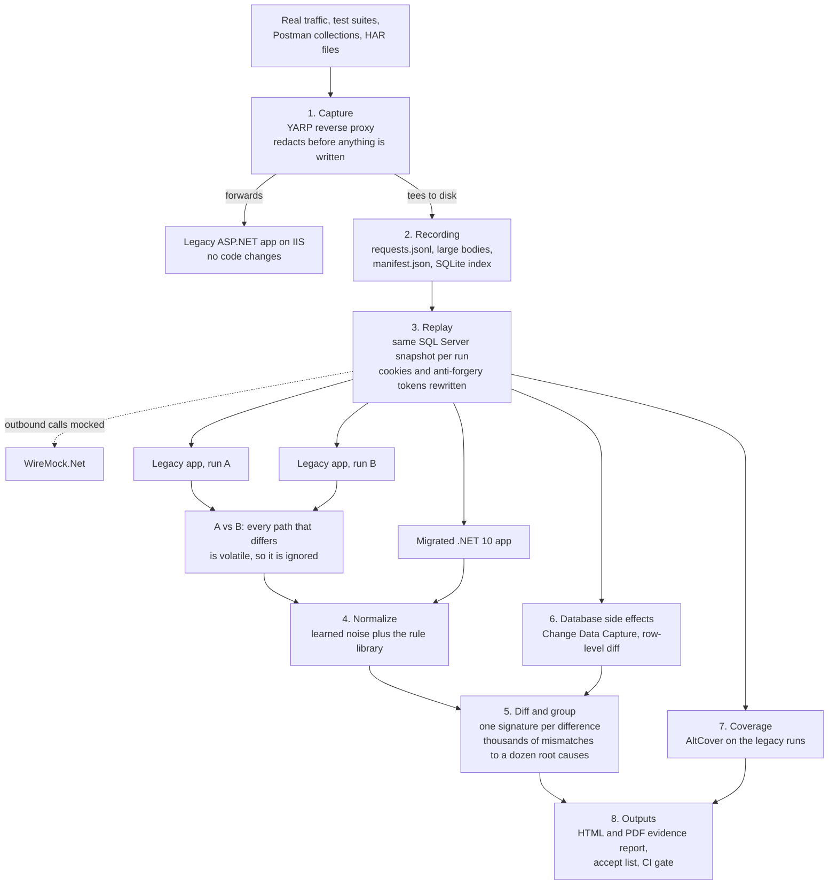
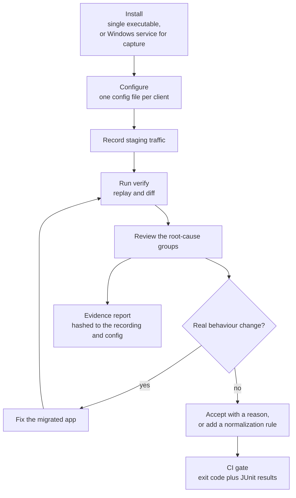

# Product flow

How a verification run actually moves, from the legacy app's live traffic to a report an auditor can tie to a hash. The step numbers match the component design in [the technical build plan](../NET%20Migration%20Verification%20Technical%20Build%20Plan.md).

Everything below runs on the customer's own infrastructure. There is no cloud backend and no outbound call during replay except to configured targets and mocks.

## The verification pipeline

The branch that matters is the one through runs A and B. Replaying the legacy app against itself is what tells the tool which differences are noise, before the migrated app is ever compared. Without it, every timestamp, generated ID and unordered list shows up as a finding and nobody triages the report.

Steps 6 and 7 arrive in Phase 4 and Phase 5; see [the roadmap](roadmap.md).

## What the operator does

Accepted differences stay in the report as an audit trail; they stop failing the build without disappearing. Every false alarm an operator marks here is the number to watch: the share of reported groups that were not real differences, target under 10%.
